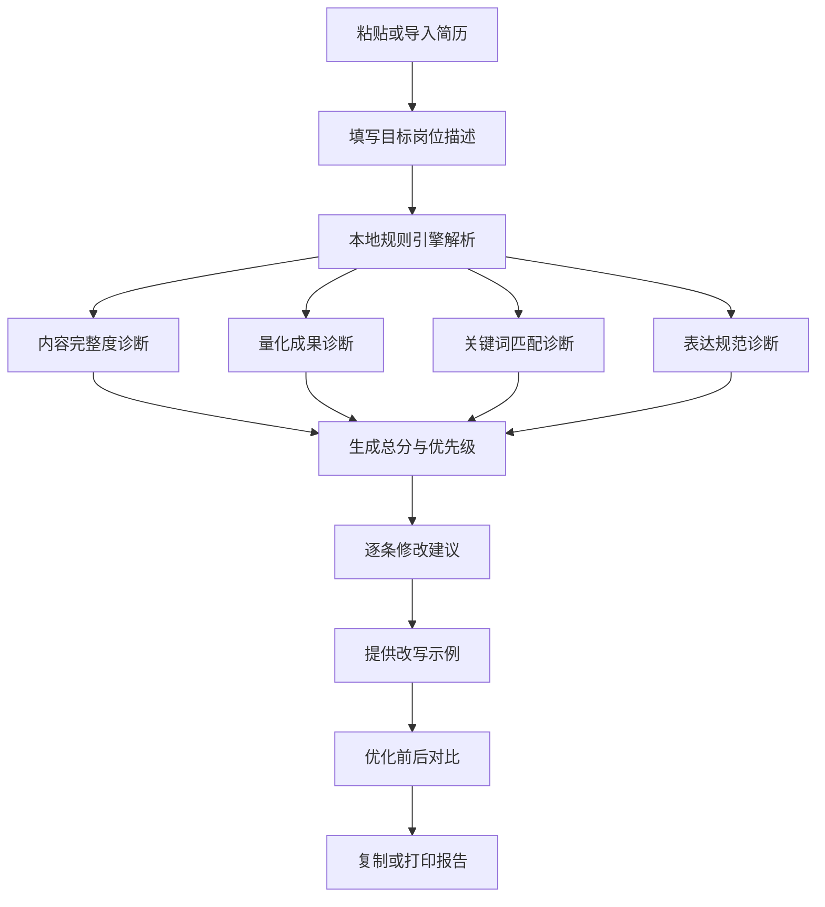

# 智能简历优化助手

面向求职者的 AI Resume Optimizer 产品原型。用户粘贴简历和目标岗位描述后，系统从内容完整度、量化成果、关键词匹配、表达规范四个维度给出诊断、逐条修改建议、改写示例与优化前后对比。

该 Demo 内置规则引擎模拟 AI 诊断，不需要 API、不需要联网，直接用浏览器打开 `index.html` 即可运行。

## 产品价值

- 将“看不懂简历哪里有问题”转化为可执行的修改清单。
- 用量化成果、岗位关键词和动作表达提升简历的筛选通过率。
- 同时展示产品闭环与用户体验：项目一讲知识可信，项目二讲反馈与转化。
- 在本地浏览器完成分析，示例数据不上传服务器。

## 目标用户

| 用户 | 核心痛点 | 产品价值 |
| --- | --- | --- |
| 应届生 | 项目像课程作业，不会写成果 | 提供量化思路和改写示例 |
| 转行求职者 | 经历与岗位关键词不匹配 | 识别技能迁移和关键词缺口 |
| 技术岗位求职者 | 项目描述偏“做了什么” | 强调技术动作、指标和结果 |
| 社招求职者 | 简历冗长，重点不突出 | 聚焦岗位相关性并压缩表达 |
| 求职辅导/职业规划人员 | 点评耗时且标准不统一 | 用统一维度快速做首轮诊断 |

## 产品流程



## 核心功能

### 1. 简历与岗位输入

- 粘贴简历正文。
- 粘贴目标岗位 JD。
- 导入本地 `.txt` 简历文件。
- 一键加载电子类专业应届生示例。

### 2. 四维智能诊断

| 维度 | 检查内容 | 示例问题 |
| --- | --- | --- |
| 内容完整度 | 联系方式、教育、技能、项目、实习等结构 | 缺少求职意向或成果栏目 |
| 量化成果 | 数字、比例、效率、成本、性能指标 | “优化了系统”没有说明提升了多少 |
| 关键词匹配 | 岗位技能、工具、职责关键词覆盖 | JD 要求 FreeRTOS，简历未出现 |
| 表达规范 | 动作词、弱表达、句长、条目结构 | 大量“负责”“参与”“熟悉” |

### 3. 可落地修改建议

每条建议包含：

- 问题等级：高、中、低。
- 原文片段：指出具体位置。
- 诊断原因：说明为什么影响筛选。
- 修改动作：告诉用户补什么信息。
- 改写示例：给出可直接借鉴的句式。

### 4. 优化前后对比

系统选择最有代表性的项目条目，展示优化前后差异：

- 优化前：职责堆叠、缺少结果。
- 优化后：动作词开头、技术方案明确、量化结果完整。

### 5. 本地隐私保护

- 所有计算在浏览器内执行。
- 不上传简历和 JD。
- 不调用第三方 API。
- 刷新页面后不保留输入内容。

## 演示场景

### 一键示例

点击“一键体验示例”，系统自动载入：

- 电子类专业应届生简历。
- 嵌入式软件工程师校招岗位描述。
- 内容完整度、量化成果、关键词匹配、表达规范评分。
- 高风险问题、缺失关键词和项目改写示例。

### 示例问题

| 问题 | 系统表现 |
| --- | --- |
| 简历缺少 Linux 经验 | 标记为岗位关键词缺口 |
| 项目只写“负责测试” | 提醒补充工具、数量和效率提升 |
| 项目未说明技术难点 | 给出 STAR + 指标改写示例 |
| 大量使用“熟悉/参与” | 建议替换为动作动词和结果 |

## 技术方案

本项目是纯静态单页应用：

- `index.html`：界面、样式、规则引擎和交互逻辑全部内嵌。
- 无构建步骤。
- 无第三方依赖。
- 无网络请求。
- 桌面和移动端自适应。

## 运行方式

### 直接打开

双击 `index.html`，或在浏览器地址栏打开该文件。

### 本地静态服务

如果需要使用本地 HTTP 地址：

```bash
python -m http.server 8000
```

然后访问：

```text
http://localhost:8000
```

## 项目指标

| 指标 | MVP 目标 |
| --- | --- |
| 诊断完成率 | >= 95% |
| 建议可执行率 | >= 85% |
| 关键词识别准确率 | >= 80% |
| 用户认为“有帮助”比例 | >= 80% |
| 页面首次可交互时间 | < 1 秒 |
| 完整诊断耗时 | < 500 毫秒 |

## 规则引擎边界

当前版本使用本地规则模拟 AI，优势是稳定、透明、无需 API；局限是语义理解能力有限：

- 不能判断经历的真实性。
- 不能替代行业专家和招聘方判断。
- 复杂长句、图表简历和扫描件解析能力有限。
- 关键词匹配依赖文本表面表达。

后续可将规则引擎替换为大模型 API，同时保留本地规则作为兜底和结果校验。

## 文档索引

- [PRD.md](PRD.md)：用户、功能、流程、指标、非功能需求与风险
- [evaluation.md](evaluation.md)：测试集、评分指标和判定标准
- [prompt-library.md](prompt-library.md)：AI 诊断、改写、岗位匹配和隐私保护提示词
- [cases.md](cases.md)：应届生、转行、无 JD、弱表达、敏感信息等测试用例
- [index.html](index.html)：可直接运行的浏览器 Demo

## 后续规划

1. 支持 PDF、DOCX 解析和简历模板识别。
2. 接入大模型生成更自然的改写方案。
3. 支持多岗位版本对比和投递记录。
4. 增加行业词库、ATS 模拟筛选和面试追问预测。
5. 提供“保守改写 / 专业强化 / 成果导向”三种风格。
